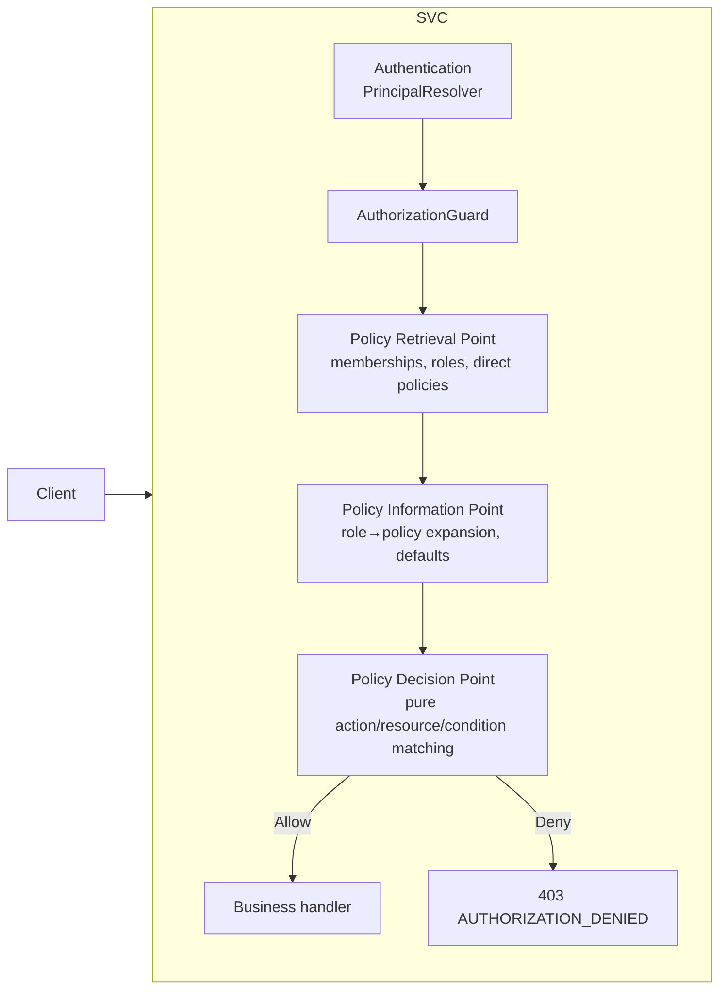
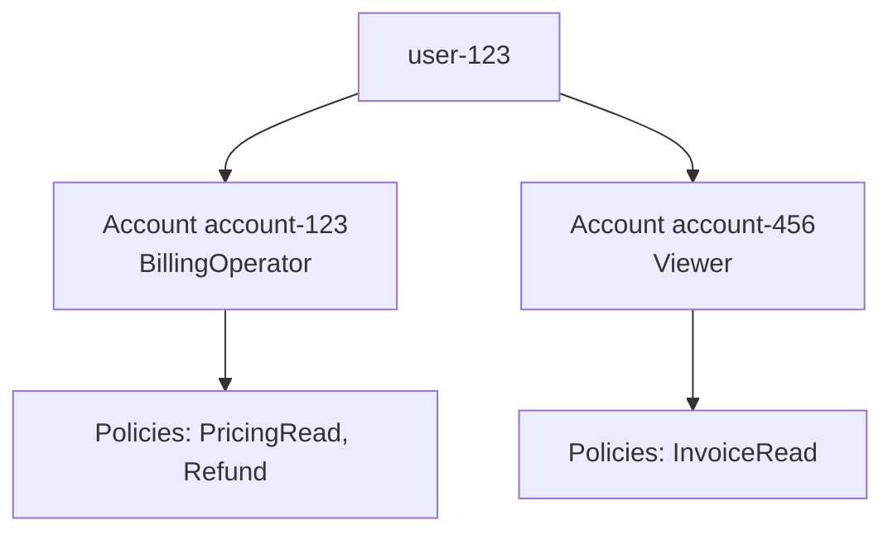

# policygate

Reusable, plug-and-play **authorization platform for NestJS microservices**.
RBAC + policy-based access control, account/tenant scoping, resource-level
checks, conditions, deny-by-default, feature gating, and structured decision
logs — behind three public surfaces:

- `AuthorizationModule.forRoot(...)` / `forRootAsync(...)`
- `@RequirePermission(...)` / `@RequirePermissions(...)`
- `authorizationService.authorize(...)` / `isFeatureEnabled(...)`

Everything else (PRP / PIP / PDP internals) is an implementation detail you
can override but never need to touch.

## What problem it solves

Authentication answers _who you are_. This package answers _what you may do_,
per request, per account, with zero trust: every protected request is
independently evaluated against current policy state, every decision is
logged, and every failure fails closed.

## Architecture



Two modes:

- **local** — PRP/PIP/PDP embedded in your process (low latency, dev, small services).
- **remote** — the guard calls a central `authorization-service` via `POST /v1/authorize`.

## Install & minimal configuration

```bash
npm install policygate
```

```ts
@Module({
  imports: [
    AuthorizationModule.forRoot({
      mode: 'local',
      principalResolver: new MyJwtPrincipalResolver(), // your auth adapter
      repositories: {
        roles: myRoleRepo, // implements RoleRepository
        policies: myPolicyRepo, // implements PolicyRepository
        memberships: myMemberships, // implements MembershipRepository
        directPolicies: myDirect, // implements DirectPolicyRepository
      },
    }),
  ],
})
export class AppModule {}
```

The guard registers globally and only activates on endpoints carrying
`@RequirePermission(s)` metadata — nothing else is intercepted.

## First protected endpoint

```ts
@RequirePermission({
  action: 'billing:ReadPricing',
  resource: 'rn:cc-api:billing::${cc:accountId}:Pricing/*',
})
@Get('/accounts/:accountId/pricing')
getPricing(@Param('accountId') accountId: string) { ... }
```

`${cc:accountId}` is resolved from the route params, but the **requested**
account is then verified against the principal's _server-side_ memberships —
a URL you don't own can never authorize you.

## Policy example

```json
{
  "name": "BillingPricingRead",
  "statements": [
    {
      "sid": "AllowPricingRead",
      "effect": "Allow",
      "actions": ["billing:ReadPricing"],
      "resources": ["rn:cc-api:billing::${cc:accountId}:Pricing/*"]
    }
  ]
}
```

## Multi-account isolation



Each account gets its own `AuthorizationContext`. A request for
`account-456` is evaluated **only** against that account's context — an
account-123 grant can never leak across.

## Feature gating

Features are ordinary policy checks — no second engine:

```ts
await authorizationService.isFeatureEnabled(principal, 'NewBillingUI', 'account-123');
```

internally evaluates action `feature:EnableNewBillingUI` against
`rn:cc-api:billing::account-123:Features/NewBillingUI`.

## Local vs remote

|           | local                     | remote                            |
| --------- | ------------------------- | --------------------------------- |
| Mode      | `mode: 'local'`           | `mode: 'remote', remote: { url }` |
| Evaluator | Embedded PRP/PIP/PDP      | `POST {url}/v1/authorize`         |
| Failure   | repo errors → fail closed | timeout/5xx → fail closed         |

```ts
AuthorizationModule.forRootAsync({
  inject: [ConfigService],
  useFactory: (cfg: ConfigService) => ({
    mode: 'remote',
    remote: { url: cfg.get('AUTHZ_EVALUATOR_URL'), timeoutMs: 2000 },
    principalResolver: new MyJwtResolver(),
  }),
});
```

## Error handling

| Condition                                 | Status | code                              |
| ----------------------------------------- | ------ | --------------------------------- |
| No applicable allow / explicit deny       | 403    | `AUTHORIZATION_DENIED`            |
| Unauthenticated principal resolver throws | 401    | `UNAUTHENTICATED`                 |
| PRP/PIP/PDP/remote failure                | 500    | `AUTHORIZATION_EVALUATION_FAILED` |

Deny responses expose only `{action, resource}` of the failed checks — never
policy internals. Detailed traces go to the decision log.

## Decision logging

Every attempt produces a structured `AuthorizationDecisionLog`
(principal, account, action, resource, decision, matched
policies/statements, duration, correlation id, service name). Replace
`DECISION_LOGGER` / `AUTHORIZATION_METRICS` with Winston, Pino, OTel,
Kafka, or a SIEM sink — never log tokens/secrets/PII.

## Commands

```bash
npm install        # install workspace deps
npm run build      # build package + apps
npm run test       # unit tests
npm run test:e2e   # HTTP integration tests (in-memory repos)
npm run test:all   # both
npm run lint       # eslint
npm run format     # prettier
npm run dev        # demo-billing-service (local mode, in-memory)
npm run dev:authz  # authorization-service (local mode, in-memory)
npm run bench      # PDP latency benchmark
npm run db:generate && npm run db:push && npm run db:seed  # prisma + postgres
podman compose up  # postgres + authorization-service + demo-billing-service
```

## Demo

`podman compose up` (requires a compose provider such as `podman-compose` or
`docker-compose` on PATH — podman itself does not bundle one; the images and
network topology were verified directly with `podman build`/`run`), or
`npm run dev`, then:

```bash
# Flow A — allow
curl -H 'x-principal-id: user-123' -H 'x-principal-type: USER' \
  http://localhost:3200/accounts/account-123/pricing

# Flow B — deny (wrong account)
curl -H 'x-principal-id: user-123' http://localhost:3200/accounts/account-456/pricing

# Flow C/D — feature gate
curl -H 'x-principal-id: user-123' http://localhost:3200/accounts/account-123/features/NewBillingUI
curl -H 'x-principal-id: user-123' http://localhost:3200/accounts/account-456/features/NewBillingUI

# Flow E — revocation (no cache): deny on the NEXT request
curl -X POST http://localhost:3200/dev/roles/role-billing-operator/revoke/policy-billing-pricing-read
curl -H 'x-principal-id: user-123' http://localhost:3200/accounts/account-123/pricing  # 403
curl -X POST http://localhost:3200/dev/reset

# Service principal via API key — direct policies, no membership
curl -H 'x-api-key: demo-reporting-key' http://localhost:3200/reports            # 200
curl -H 'x-api-key: demo-reporting-key' http://localhost:3200/accounts/account-123/invoices  # 403
```

The demo authenticates callers through `CompositePrincipalResolver`
(API key → edge headers). `svc-reporting` holds a directly attached
`ServiceReportingRead` policy on an account-agnostic resource; because a
principal-scoped context has no `accountId`, `${cc:accountId}` can never
resolve there — a direct policy can grant `Reports/*` but can never reach
tenant data.

## Testing

- `packages/policygate/test/*.spec.ts` — matcher, variables,
  conditions, PDP rules, multi-account isolation, PRP/PIP, guard, service,
  feature gating, remote evaluator.
- `apps/demo-billing-service/test/billing.e2e-spec.ts` — full HTTP pipeline
  including revocation and remote-failure fail-closed.

## Extension points

All adapters are interfaces bound to DI tokens — swap without touching the
engine: `PrincipalResolver`, `AccountContextResolver`, `PolicyRetrievalPoint`,
`PolicyInformationPoint`, `PolicyDecisionPoint`, `AuthorizationEvaluator`,
`VariableResolver`, `ConditionEvaluator` (+ custom `ConditionOperator`s),
`AuthorizationDecisionLogger`, `AuthorizationMetrics`, and all repositories
(Prisma reference impl + in-memory included). Designed-forward extension
points (not implemented): Redis cache, Dynamo/Mongo repos, OPA/Cedar
adapter, OTel, Kafka decision events, policy versioning/approval, shadow
evaluation, cohort/percentage rollouts, step-up auth, separation of duties.

## Important notes

- **No caching by default** — every request evaluates current policy state,
  so revocation takes effect on the next request. A future
  `ScopedAuthorizationCache` can wrap the evaluator without touching
  guards/decorators, but must not weaken revocation semantics for
  sensitive writes.
- **Fail closed** — infrastructure errors never produce `allowed=true`.
- The PDP performs **no I/O** — DB/network work lives in PRP/PIP.

See `docs/` for architecture, policy model, evaluation rules, integration,
and examples.

## Repository layout

| Path                              | Contents                                                    |
| --------------------------------- | ----------------------------------------------------------- |
| `packages/policygate`             | The publishable library (all engine code + tests)           |
| `apps/authorization-service`      | Central PDP service — `POST /v1/authorize`                  |
| `apps/demo-billing-service`       | Reference consumer — protected billing endpoints + `/dev`   |
| `prisma/`                         | Schema + seed for the Postgres persistence mode             |
| `benchmarks/`                     | PDP latency microbenchmark (`npm run bench`)                |
| `docs/`                           | Architecture, policy model, evaluation rules, integration   |
| `compose.yaml` + `Containerfile`s | Full-stack podman deployment (postgres + both apps)         |

## License

MIT — see `LICENSE`.
