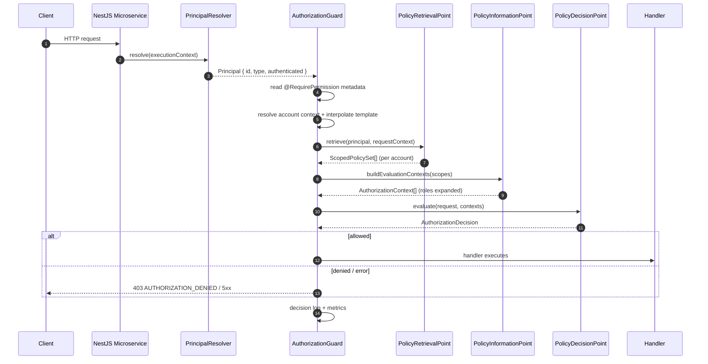
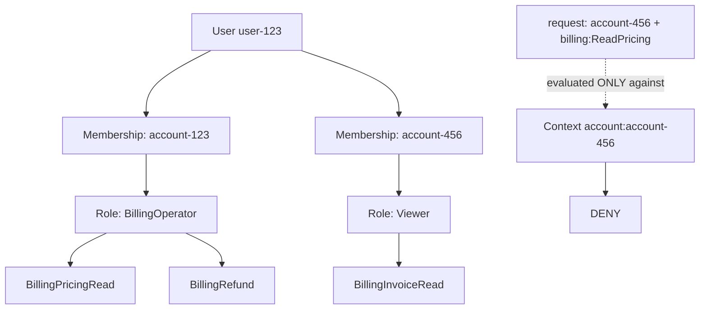
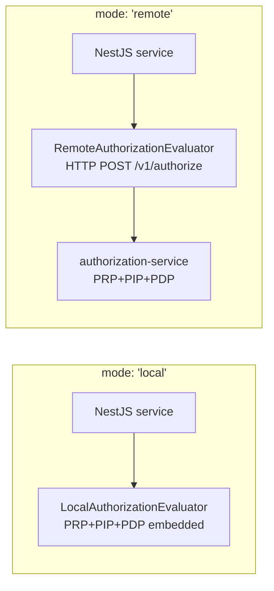
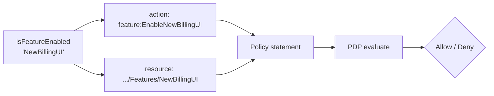
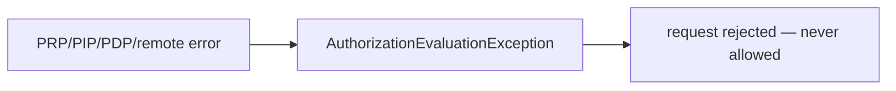

# Architecture

## Authentication → normalized Principal

Customer JWTs, internal support/operations tokens, portal tokens, and API
keys are all reduced to one `Principal { id, type, authenticated }` by a
`PrincipalResolver`. **Identity ≠ authority** — authentication only
decides WHO is calling; the policy engine decides what they may do.
`CompositePrincipalResolver` chains mechanisms (API key → bearer → header)
and takes the first authenticated result; all-absent produces the
anonymous principal, which can only reach `unauthenticatedSystemDefault`
policies.

```mermaid
flowchart LR
  A[Customer JWT] --> C[CompositePrincipalResolver]
  B[Internal-ops JWT / portal token] --> C
  K[API key] --> C
  H[Edge headers (dev)] --> C
  C --> P[Principal: id + USER/AGENT/SERVICE + authenticated]
  P --> G[AuthorizationGuard → PRP → PIP → PDP]
```

## Request flow



## Multi-account isolation



The PDP filters contexts by `request.accountId`. When a request is
account-scoped, only the matching context is evaluated.

## Local vs remote



## Feature gating (same engine)



## Component responsibilities

| Component                | Responsibility                                              | I/O?          |
| ------------------------ | ----------------------------------------------------------- | ------------- |
| `PrincipalResolver`      | Identity only (JWT/session/API-key adapters)                | Yes (edge)    |
| `AuthorizationGuard`     | Metadata, template interpolation, orchestration             | Calls service |
| `PolicyRetrievalPoint`   | Which scopes apply (memberships, direct policies, defaults) | Reads repos   |
| `PolicyInformationPoint` | Materializes contexts (role→policy expansion)               | Reads repos   |
| `PolicyDecisionPoint`    | Pure matching: actions, resources, conditions, effects      | **None**      |
| `AuthorizationService`   | Public API, decision logging, metrics                       | —             |
| `AccountContextResolver` | Trusted account context from route/server state             | —             |
| `VariableResolver`       | `${key}` interpolation                                      | None          |
| `ConditionEvaluator`     | Pluggable operator blocks                                   | None          |

## Failure model

All failures fail closed:



`AuthorizationDeniedException` (403) for policy denials;
`AuthorizationEvaluationException` (500) for infrastructure failures;
`AuthorizationConfigurationException` for misconfiguration at boot or for
malformed persisted policies.
