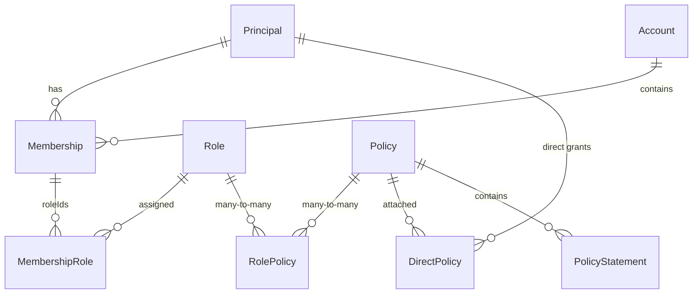

# Policy model

## Entities



## Role flags

| Flag                           | Meaning                                                                                                                                                              |
| ------------------------------ | -------------------------------------------------------------------------------------------------------------------------------------------------------------------- |
| `systemDefault`                | Auto-applies to every **authenticated** principal (all scopes).                                                                                                      |
| `unauthenticatedSystemDefault` | Applies to unauthenticated requests.                                                                                                                                 |
| `internalAgentOnly`            | Stripped for non-`AGENT` principals — in **both** PRP (system defaults) and PIP (expansion), so a membership-granted internal role still can't be used by customers. |

## Policy statement

```jsonc
{
  "sid": "AllowPricingRead", // optional, improves decision traces
  "effect": "Allow", // or "Deny"
  "actions": ["billing:ReadPricing"],
  "resources": ["rn:cc-api:billing::${cc:accountId}:Pricing/*"],
  "conditions": {
    // optional
    "StringEquals": { "cc:env": "prod" },
  },
}
```

## Resource naming

ARN-like: `rn:<service>:<domain>::<accountId>:<resource>/<identifier>`

```
rn:cc-api:billing::account-123:Pricing/*
rn:cc-api:network::account-123:Port/port-42
```

Variables `${cc:accountId}` inside policies resolve **per evaluation
context** from trusted server-side data (the membership account id), never
raw client input.

## Built-in variables

| Variable           | Source                                     |
| ------------------ | ------------------------------------------ |
| `cc:principalId`   | principal.id                               |
| `cc:principalType` | principal.type                             |
| `cc:accountId`     | **evaluation context** accountId (trusted) |
| `cc:<paramName>`   | route params (used in endpoint templates)  |
| `cc:request:<key>` | requestContext entries                     |

## Conditions

Operators are ANDed across blocks and across keys:

`StringEquals`, `StringNotEquals`, `StringLike` (wildcard), `StringNotLike`,
`NumericEquals`, `NumericGreaterThan`, `NumericLessThan`, `Exists`.

Add an operator by implementing `ConditionOperator` and passing it to
`DefaultConditionEvaluator` — no PDP changes needed.
